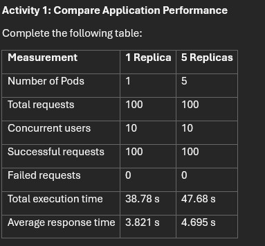
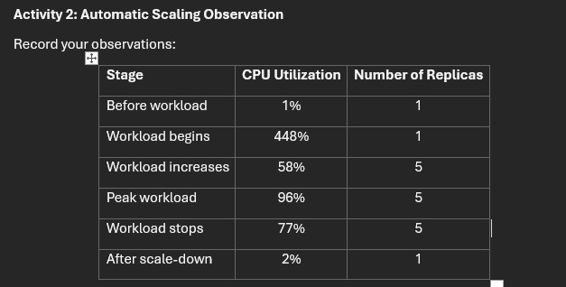
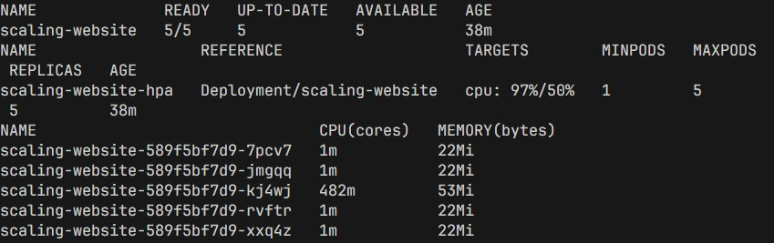

## Load Testing and Horizontal Pod Autoscaling Results

### Project Overview

This project demonstrates manual and automatic scaling
of a Python Flask application deployed to a local
Docker Desktop Kubernetes cluster.

The application exposes a CPU-intensive `/work` endpoint
to simulate increased website traffic.

### Technologies

- Python and Flask
- Docker and Docker Desktop
- Kubernetes and kubectl
- Kubernetes Metrics Server
- Horizontal Pod Autoscaler (HPA)
- PowerShell

### HPA Configuration

| Setting | Value |
|---|---|
| Minimum replicas | 1 |
| Maximum replicas | 5 |
| Target CPU utilization | 50% |
| CPU request per Pod | 100m |
| CPU limit per Pod | 500m |

### Activity 1: Application Performance

The load-testing script sent 100 HTTP requests using
10 concurrent workers.

| Measurement | 1 Replica | 5 Replicas |
|---|---:|---:|
| Number of Pods | 1 | 5 |
| Total requests | 100 | 100 |
| Concurrent users | 10 | 10 |
| Successful requests | 100 | 100 |
| Failed requests | 0 | 0 |
| Total execution time | 38.78 s | 47.68 s |
| Average response time | 3.821 s | 4.695 s |

Both configurations processed all requests successfully.

The five-replica test took longer than the single-replica
test. However, Kubernetes port forwarding selected one
Pod rather than distributing requests across all replicas.

Therefore, these results are not a reliable comparison
of distributed load-balancing performance.

### Activity 2: Automatic Scaling Observation

A continuous Python workload generator sent requests
to the CPU-intensive `/work` endpoint.

| Stage | CPU Utilization | Replicas |
|---|---:|---:|
| Before workload | 1% | 1 |
| Workload begins | 448% | 1 |
| Workload increases | 58% | 5 |
| High-load stage at 5 replicas | 96% | 5 |
| Workload stops | 77% | 5 |
| After scale-down | 2% | 1 |

The highest CPU percentage listed was observed at the
beginning of the workload, before additional Pods were
ready.

The HPA increased the Deployment to five replicas in
response to CPU utilization exceeding the 50% target.

After the workload stopped, CPU utilization decreased
and the HPA eventually reduced the Deployment to one
replica.

### HPA and Pod Resource Monitoring

Kubernetes reported five available application Pods.

During one measurement:
- HPA average CPU utilization: 97%
- HPA target: 50%
- Available replicas: 5
- Highest individual Pod CPU usage: 482m

Most traffic reached one Pod because the application
was accessed through kubectl port-forward.

The HPA nevertheless responded to the observed CPU
utilization by increasing the replica count.

### Key Learnings

- Kubernetes Deployments manage application replicas.
- Manual scaling requires an administrator command.
- HPA automatically adjusts replicas using CPU metrics.
- Metrics Server provides CPU utilization measurements.
- HPA CPU utilization is calculated relative to CPU requests.
- Scale-down may be delayed by stabilization settings.
- Port forwarding is not a substitute for testing
  Kubernetes Service load balancing.

### Conclusion

The experiment successfully demonstrated CPU-based
horizontal autoscaling from one to five Pods and
automatic scale-down after the workload stopped.

It also demonstrated the importance of understanding
how traffic reaches Pods when interpreting load-test
results.
